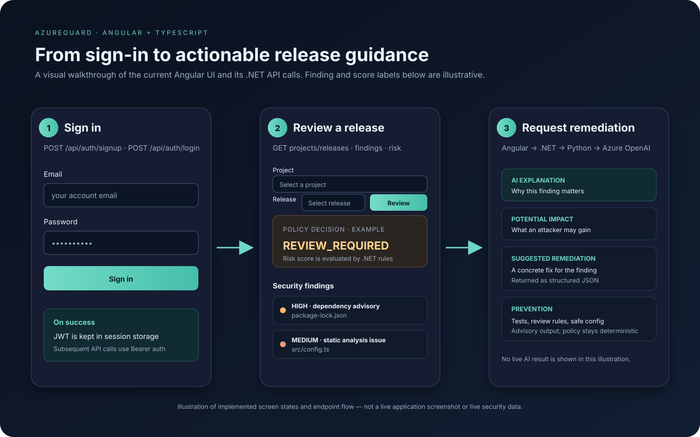
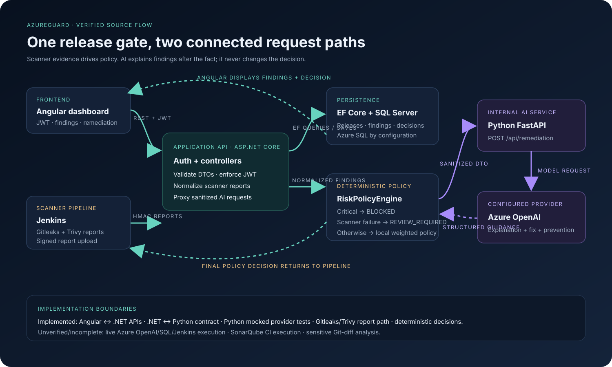

# AzureGuard

AzureGuard is a DevSecOps release-risk project built on the existing ASP.NET Core API, EF Core SQL Server models, repository layer, scanner report parsers and deterministic risk policy. The primary dashboard is Angular + TypeScript in `frontend-angular/`. The existing React/Vite app in `frontend/` remains available during the transition.

## Visual walkthrough

The first visual illustrates the Angular sign-in, release review, finding list and remediation panel. Its release/finding values are illustrative UI content, not a captured live session or a claim that Azure OpenAI has returned that text.



The system diagram below follows the implemented request boundaries. It also calls out features that remain incomplete or unverified.



## What happens in the application

1. A user creates an account through `POST /api/auth/signup` or signs in through `POST /api/auth/login`. Angular stores the returned JWT in session storage and sends it as a Bearer token to protected endpoints.
2. Angular loads projects from `GET /api/projects`. The **Add project** form calls `POST /api/projects`; the existing API analyzes the supplied public GitHub repository and creates the project.
3. Selecting a project loads `GET /api/projects/{projectId}/releases`. The **Create release** form calls `POST /api/projects/{projectId}/releases`; selecting a release then loads its findings and risk decision.
4. Angular requests findings from `GET /api/releases/{releaseId}/findings?page=1&pageSize=50` and the policy result from `POST /api/releases/{releaseId}/risk-evaluation`. ASP.NET Core reads EF Core/SQL Server data. `RiskPolicyEngine` determines `APPROVED`, `REVIEW_REQUIRED`, or `BLOCKED`; AI does not make this decision.
5. **Explain remediation** posts finding metadata to `POST /api/ai/remediation`. The .NET API sanitizes and forwards it to Python FastAPI at `POST /api/remediation` using `AI__BaseUrl`. Python validates the camel-case request, sanitizes it again, and calls the configured Azure OpenAI deployment. This existing feature remains advisory.
6. For pull requests, GitHub Actions can submit the base-to-head patch to the existing signed report endpoint when the AzureGuard API, project, release, and webhook-secret GitHub secrets are configured. The .NET service filters for auth, authorization, security and configuration files; redacts secrets; bounds source context; then calls the existing Python FastAPI service at `POST /api/change-impact`. Python treats code as untrusted data, validates structured JSON, and calls Azure OpenAI. .NET stores only the analysis result and commit reference in SQL; raw diffs are not persisted. Angular reads the latest result from `GET /api/projects/{projectId}/releases/{releaseId}/change-impact`.
7. Jenkins also runs Gitleaks, Trivy and commit diff analysis and signs report uploads. Sensitive paths and selected security-control changes feed normalized findings to the deterministic .NET risk engine. AI assessment is not used for release approval/blocking; the policy engine remains authoritative.

React/Vite is retained during transition; Angular is the primary frontend and now has signup, project, release, findings, risk and remediation flows.

## Local setup

### Required configuration

Use .NET 8, Node.js 24, Python 3.12, and SQL Server or Azure SQL. Copy `.env.example` to `.env` and replace every `REPLACE_...`/`YOUR_...` value. Never commit the filled-in `.env` file or real credentials.

For Compose, `AZUREGUARD_SQL_CONNECTION` must point to the service host `db`, and its password must match `SQL_PASSWORD`, for example:

```text
AZUREGUARD_SQL_CONNECTION=Server=db,1433;Database=AzureGuard;User Id=sa;Password=<same value as SQL_PASSWORD>;Encrypt=False;
```

Set a long random `JWT_KEY`. Azure model ID is `gpt-4.1-mini` (model version `2025-04-14`); the Azure deployment name is a resource-specific alias and is passed to the API as `model`. The configured default is `AZURE_OPENAI_DEPLOYMENT=gpt-4.1-mini`, so create a deployment with that name or set the environment variable to the name actually created in your resource. Region/quota availability is determined by your Azure resource. This uses Azure OpenAI API version `v1` with the OpenAI Python SDK at `/openai/v1/chat/completions`; the SDK authenticates with the configured API key. Set `AZURE_OPENAI_ENDPOINT` and `AZURE_OPENAI_API_KEY` only through environment variables or a secure secret store such as Key Vault. `.env.example` leaves those sensitive values blank. The service returns HTTP 503 when endpoint/key configuration is missing and never fabricates an analysis. `AZURE_OPENAI_TIMEOUT_SECONDS` defaults to 25. Automated tests inject explicit mocks and make no live model call. [Microsoft's v1 chat API reference](https://learn.microsoft.com/en-us/azure/foundry/openai/latest) documents the v1 endpoint and deployment-name parameter; the [model catalog](https://learn.microsoft.com/en-us/azure/ai-services/openai/concepts/models) lists gpt-4.1-mini and its supported chat-completions capability.

The repository includes a repeatable local SQL baseline and upgrades. Compose starts SQL Server but does not apply schema changes automatically. After starting the Compose database, run `tools/initialize-local-sql.ps1` from PowerShell. It creates the database only if missing and applies `001_initial_schema.sql`, `002_add_auth_password_hash.sql`, and `003_phase1_release_core.sql` in order. The scripts are safe to re-run and do not drop tables or rows. Install Microsoft `sqlcmd`; use Windows integrated auth by default, or set `SQL_USER` and `SQL_PASSWORD` for SQL authentication. For an existing/shared database, review the SQL files and take a backup before applying schema upgrades.

### Run all local services with Docker Compose

1. Copy `.env.example` to `.env` and fill in SQL and JWT settings. Add Azure OpenAI endpoint/key from a secret store to enable live AI requests. Without them, containers can start, but AI endpoints return an explicit unavailable error; no fallback response is generated.
2. Start SQL Server and initialize its schema:

   ```powershell
   docker compose up -d db
   $env:SQL_USER = 'sa'
   $env:SQL_PASSWORD = '<same value as SQL_PASSWORD in .env>'
   .\tools\initialize-local-sql.ps1
   ```

3. From the repository root, run:

   ```powershell
   docker compose up --build
   ```

4. Open Angular at `http://localhost:4200`. The API is published at `http://localhost:5006`; the Python AI service stays on the Compose network and is reached by the API at `http://ai:8000`.

### Run services directly for development

Start SQL Server/Azure SQL and initialize its schema. When running services directly, PowerShell does not automatically read `.env`, so export the .NET settings in the API terminal (use your own local SQL credentials):

```powershell
$env:ConnectionStrings__DefaultConnection = 'Server=localhost,1433;Database=AzureGuard;User Id=sa;Password=<your-local-password>;Encrypt=False;'
$env:Jwt__Key = '<a-random-secret-of-at-least-32-characters>'
$env:AI__BaseUrl = 'http://localhost:8000'
dotnet run --project backend/AzureGuard/AzureGuard
```

In a second terminal from the repository root, export the Azure OpenAI values, then install and start the Python service:

```powershell
$env:AZURE_OPENAI_ENDPOINT = 'https://<your-resource>.openai.azure.com'
$env:AZURE_OPENAI_API_KEY = '<your-key>'
$env:AZURE_OPENAI_DEPLOYMENT = 'gpt-4.1-mini'
$env:AZURE_OPENAI_API_VERSION = 'v1'
$env:AZURE_OPENAI_TIMEOUT_SECONDS = '25'
python -m pip install -r ai-service/requirements.txt
python -m uvicorn app.main:app --app-dir ai-service --host 127.0.0.1 --port 8000
```

In a third terminal, start Angular:

```powershell
cd frontend-angular
npm ci
npm start -- --open
```

The API must be reachable at `http://localhost:5006/api`. Angular signup creates the account directly; the React app remains available during transition.

## Try the real application flow

1. Create an account using the Angular signup form.
2. Add a project with a public GitHub repository URL. The API currently rejects non-GitHub repository hosts.
3. Select the project and create a release; Angular then offers it in the release selector.
4. Review the selected release. If no scanner reports exist, the application displays the actual empty/current state, not fabricated scan results.
5. Trigger Jenkins or upload a supported report. Jenkins reports Gitleaks, Trivy and the diff between `HEAD^` and `HEAD`; the first commit has no parent and therefore produces an empty diff. Sensitive changes become normalized findings and require review.
6. Click **Explain remediation** on a finding for the existing remediation flow. For pull-request change impact, configure the GitHub Actions secrets `AZUREGUARD_API_URL` (ending in `/api`), `AZUREGUARD_PROJECT_ID`, `AZUREGUARD_RELEASE_ID`, and `AZUREGUARD_WEBHOOK_SECRET`. The target release must already exist and the webhook secret must match the API's Jenkins webhook secret. On PR workflow runs, GitHub Actions signs the base-to-head diff and posts it to the API; the AI analysis appears in the selected release dashboard. A missing Azure endpoint/key is saved as `UNAVAILABLE`, not replaced with a mock response.

If Angular reports `Http failure response ... 0 undefined`, the browser could not reach the API at `localhost:5006`; start the API and check its SQL configuration. If login returns unauthorized after the API is reachable, confirm the account was registered in the same database. If remediation returns service unavailable, check `AI__BaseUrl` from the API host and the Azure OpenAI settings available to the Python process.

## API routes used by the UI and pipeline

- `POST /api/auth/signup`, `POST /api/auth/login`
- `GET`/`POST /api/projects`; `GET`/`POST /api/projects/{projectId}/releases`
- `GET /api/releases/{releaseId}/findings?page=1&pageSize=50`
- `POST /api/releases/{releaseId}/risk-evaluation`
- `POST /api/ai/remediation` → internal Python `POST /api/remediation`
- Signed PR diff report: `POST /api/projects/{projectId}/releases/{releaseId}/reports/raw?scanType=GIT_DIFF&toolName=GIT_DIFF&status=PASSED&finalize=false&commitReference={sha}`
- Internal Python impact endpoint: `POST /api/change-impact`; latest stored result: `GET /api/projects/{projectId}/releases/{releaseId}/change-impact`
- Existing nested release routes for scan ingestion, scanner report upload, dashboard, pipeline trigger, approve/reject, and deployment gate

## Build and test commands

```powershell
dotnet restore backend/AzureGuard/AzureGuard.sln --configfile backend/NuGet.Config -m:1
dotnet build backend/AzureGuard/AzureGuard.sln -c Release --no-restore -m:1
dotnet test backend/AzureGuard/AzureGuard.sln -c Release --no-build -m:1
npm ci --prefix frontend-angular
npm run build --prefix frontend-angular
npm ci --prefix frontend
npm run build --prefix frontend
python -m pip install -r ai-service/requirements.txt
python -m compileall ai-service/app
python -m pytest ai-service/tests -q
docker compose --env-file .env config
```

## Integration and scope status

GitHub Actions builds/tests .NET, builds Angular and retained React, runs the mocked Python AI tests, Gitleaks and Trivy. On pull requests, the diff upload step runs only when the API/project/release/webhook secrets are all configured; its `finalize=false` upload does not change release policy status. Jenkins submits Git diff, Gitleaks and Trivy reports and enforces the deterministic policy decision. Configure GitHub required status checks and branch protection separately.

SonarQube report JSON (`issues` array) is normalized by the existing report endpoint and has parser fixture tests. GitHub Actions runs Sonar analysis only when `SONAR_HOST_URL`, `SONAR_TOKEN`, and `SONAR_PROJECT_KEY` secrets are all configured; it does not automatically upload Sonar issues to a release. AI change-impact uses the same Python FastAPI service as remediation, the deployment name defaults to `gpt-4.1-mini`, and API version is `v1`. Tests use mocks; no authenticated Azure OpenAI request has been made in this environment. Azure SQL, Jenkins credentials, scanner execution, Sonar server, and Docker image startup require their configured external services. No production-readiness claim is made.

More detail: [architecture](docs/ARCHITECTURE.md), [implementation status](docs/IMPLEMENTATION_STATUS.md), and [security design](docs/SECURITY_DESIGN.md).
